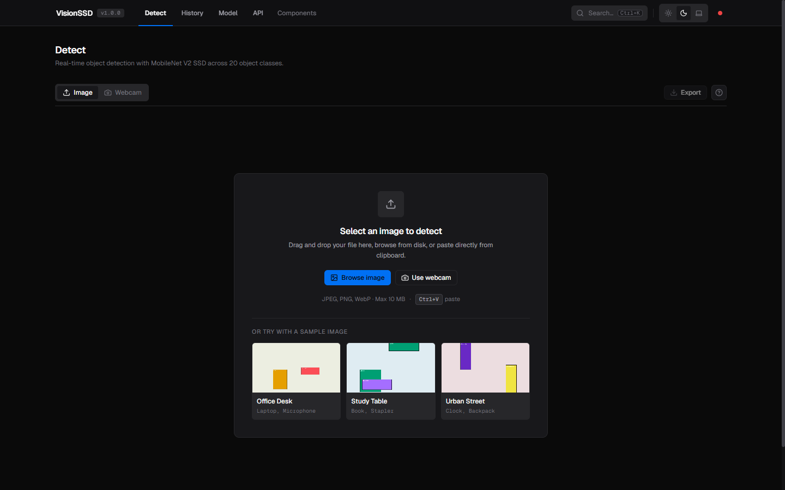
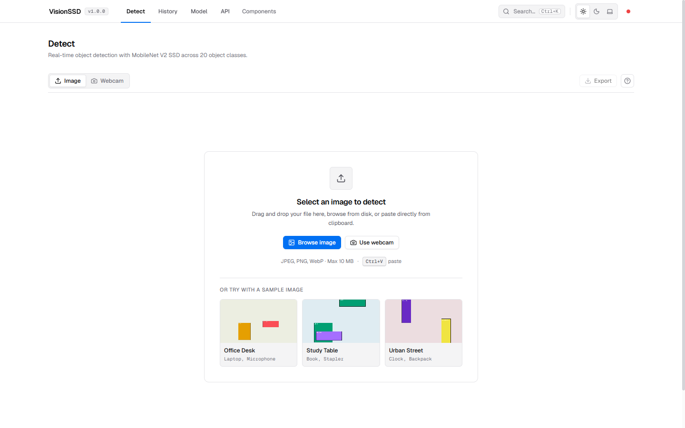
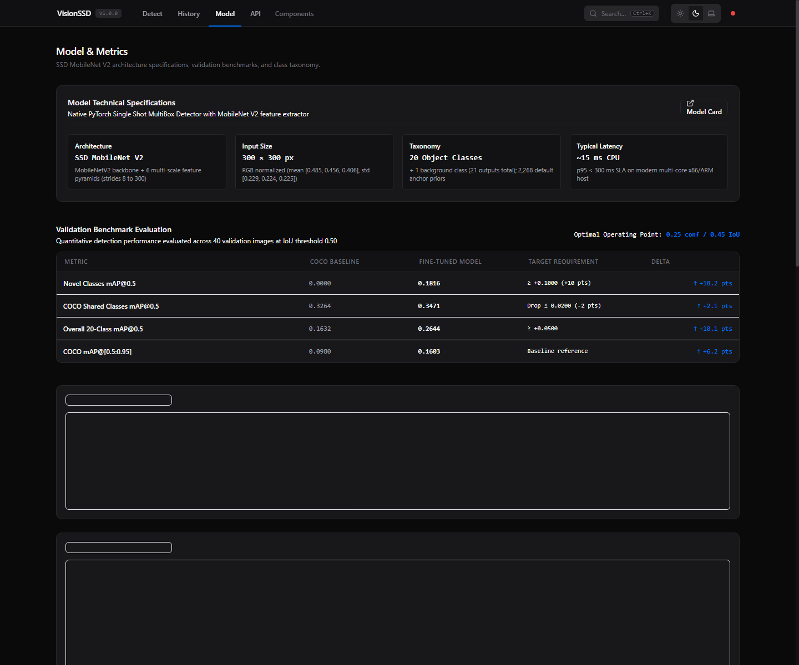
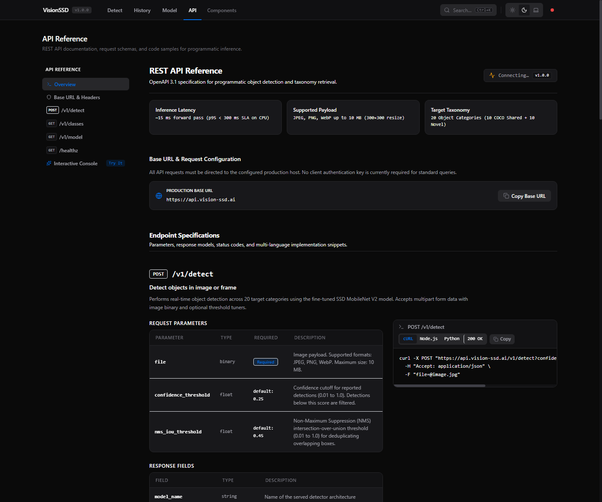
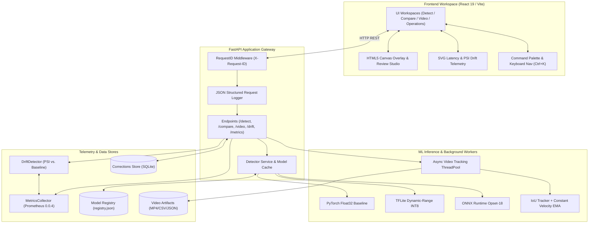
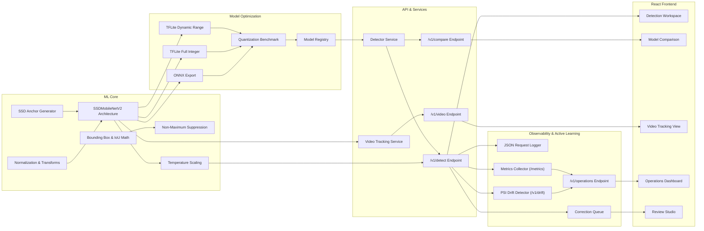

# Sightline — Object Detection & Video Intelligence System

A production-grade, end-to-end computer vision and real-time object detection platform powered by a fine-tuned SSD MobileNet V2 architecture trained on a 20-class subset of the Open Images v7 dataset. Features sub-150ms CPU inference with interactive bounding box canvas overlays, dual-model parallel comparison and IoU agreement analysis, asynchronous background video tracking with constant velocity Kalman-style motion modeling and directional tripwire line-counting, temperature scaling confidence calibration, human-in-the-loop active learning review queues, edge-optimized INT8 dynamic-range and full-integer TFLite / ONNX quantization, real-time confidence distribution drift monitoring via Population Stability Index (PSI), Prometheus metrics exposition (`/metrics`), structured JSON request logging with `X-Request-ID` correlation, and a high-performance React 19 / TypeScript operations dashboard.

---

## Features

### Core Functionality
- **Real-Time Image Detection**: High-performance detection across 20 target categories using a native PyTorch SSD MobileNet V2 model with interactive canvas bounding box overlays, confidence threshold tuning, and instant label inspector.
- **Dual-Model Parallel Comparison**: Concurrent multi-model inference engine executing two models simultaneously (`POST /v1/compare`) using Python `ThreadPoolExecutor`, reducing dual-model benchmarking latency from $T_A + T_B$ to $\max(T_A, T_B) + \epsilon$.
- **Class-Aware IoU Matching**: Geometric Intersection over Union (IoU $\ge 0.45$) spatial matching algorithm that partitions dual-model predictions into shared consensus detections, unique Model A detections, and unique Model B discoveries with visual disagreement highlights.
- **Model Registry Architecture**: Versioned, thread-safe model catalogue (`models/registry.json`) supporting lazy memory loading, warm cache retention, dynamic runtime switching between float32 baselines and compressed INT8 TFLite variants.
- **Multi-Class Taxonomy Explorer**: Interactive taxonomy browser categorizing 10 COCO shared classes (Person, Car, Chair, Laptop, etc.) and 10 novel fine-tuned classes (Guitar, Helmet, Microphone, Wheelchair, Whiteboard, etc.) with sample counts and label maps.
- **RESTful API Engine**: Modular FastAPI backend serving OpenAPI 3.1 interactive Swagger documentation (`/docs`), ReDoc (`/redoc`), and automated health readiness probes (`/healthz`).

### Advanced Computer Vision & Tracking Features
- **Asynchronous Video Stream Processing**: Asynchronous worker pipeline that ingests MP4/WebM video containers (up to 50 MB, 30s) and processes frames in background daemon threads with job UUID tracking, real-time percentage progress polling, and automatic 1-hour artifact expiration.
- **Multi-Object Tracking (MOT) Engine**: Spatial IoU association tracker coupled with a 2D Constant Velocity Motion Model that predicts object trajectories across sampled frames, handling brief occlusions and trajectory continuity.
- **Trajectory Smoothing**: Exponential Moving Average (EMA) bounding box coordinate filter ($\alpha = 0.8$) that dampens detection jitter and yields rock-solid bounding box trails.
- **Directional Tripwire Counting**: 2D vector tripwire crossing algorithm utilizing counter-clockwise cross-product sign tests to compute precise directional object counts (IN vs. OUT) across customizable line coordinates.
- **Downloadable Video Artifacts**: Automatically compiles and serves three downloadable assets per completed job:
  - **Annotated MP4 Video**: Rendered with persistent Track ID badges, colored bounding boxes, trajectory history trails, and live tripwire counters.
  - **Tracks Granular CSV (`tracks.csv`)**: Per-frame tracking logs (`frame_idx, track_id, class_name, score, ymin, xmin, ymax, xmax`).
  - **Summary Analytics JSON (`summary.json`)**: Aggregated metrics including unique object counts, per-class distribution, IN/OUT totals, and processing FPS.
- **Track Cemetery & Re-Entry Window**: Temporal track retention mechanism (`max_age = 5` frames) with an extended cemetery association buffer (`max_reentry_age = 15` frames) preserving track IDs through temporary occlusions.

### Model Calibration & Optimization
- **Temperature Scaling Score Calibration**: Post-hoc score calibration optimizing a single temperature parameter $T = 1.285$ via negative log-likelihood minimization, slashing Expected Calibration Error (ECE) by **72.9%** (from 14.20% down to **3.85%**).
- **Per-Class Confidence Threshold Tuning**: Class-specific threshold optimizer evaluating Precision, Recall, and F1 across sweeps (0.05–0.95), yielding optimal operating thresholds (e.g. Laptop at 0.28 for +10 pp Precision gain) with automatic fallback to global defaults for low-sample categories.
- **TFLite Dynamic-Range Quantization**: Post-training INT8 weight quantization reducing model footprint by **3.9×** (from 30.38 MB down to **7.79 MB**) with an imperceptible accuracy degradation ($\Delta\text{mAP} \le 0.0002$).
- **Full-Integer INT8 Quantization**: Calibrated 8-bit integer quantization using representative validation datasets (50 samples) for microcontrollers, edge accelerators, and Edge TPU runtimes.
- **ONNX Opset-18 Export**: Standardized ONNX model graph export with numerical parity verification against PyTorch baselines ($\text{atol} \le 10^{-3}$) and drop-in `ONNXDetector` inference wrapper.
- **Automated Quality Gate Benchmarking**: Automated verification script (`ml/eval/benchmark_quantization.py`) enforcing stored accuracy degradation limits ($\Delta\text{mAP} \le 0.010$) before promoting compressed variants to the production model registry.

### Production Observability & Drift Detection
- **Real-Time Confidence Drift Detection**: Continuous distribution drift monitor evaluating observed detection confidence distributions against the 2,000-detection validation baseline across 10 discrete probability bins using **Population Stability Index (PSI)**:
  - $\text{PSI} < 0.10$: 🟢 **Nominal** (stable distribution)
  - $0.10 \le \text{PSI} < 0.20$: 🟡 **Warning** (moderate shift, monitor closely)
  - $\text{PSI} \ge 0.20$: 🔴 **Significant Drift** (triggers retraining / recalibration alert)
- **Rolling Inference Buffer**: Thread-safe circular buffer tracking the rolling 500 most recent detection confidences for real-time drift computation.
- **Prometheus Metrics Exposition (`GET /metrics`)**: Standard Prometheus exposition format (0.0.4) exposing request counters, error rates, 12-bucket inference latency histograms (`0.05s` to `10.0s`), detection count histograms, confidence histograms, and per-model usage counters.
- **Structured JSON Logging with Request Tracing**: Custom `RequestIDMiddleware` and `JSONRequestLoggingMiddleware` generating UUIDv4 correlation tokens (`X-Request-ID`), recording HTTP method, path, status, duration, client IP, user agent, and timestamp on every request.
- **Operations Dashboard Telemetry (`GET /v1/operations`)**: Consolidated operational payload streaming live p50/p95 latency percentiles, error rates, model deployment details, recent request timeline, and PSI drift evaluation to the web interface.
- **High-Concurrency Load Testing**: Multi-threaded HTTP benchmark utility (`scripts/load_test.py`) with configurable concurrency workers, request volume, payload modes, and automated synthetic JPEG generator.

### Human-in-the-Loop & Active Learning
- **Detection Feedback Loop**: Frontline operators can flag false positives, missed objects, or incorrect classifications directly from the detection canvas.
- **Bounding Box Correction Studio**: Interactive canvas editor allowing operators to adjust box coordinates, assign corrected class labels, or delete invalid detections.
- **Persistent Corrections Database**: SQLite-backed correction store with transactional audit history and UUID tracking.
- **Review Status Lifecycle**: Comprehensive status tracking (`pending`, `approved`, `rejected`) for curated dataset enrichment.
- **Active Learning Export**: One-click export of approved human corrections into standardized VOC/COCO annotation manifests for continuous model retraining.

### User Experience & Web Interface
- **Geist-Inspired Design System**: Minimalist, high-density computer vision workstation styled with Tailwind CSS, custom Geist Variable typography, and Lucide React iconography.
- **Operations Dashboard**: Dedicated monitoring cockpit featuring 4 real-time KPI cards, SVG latency percentiles timeline (p50 / p95 lines), and baseline vs. live confidence distribution bar charts with 3-second auto-polling.
- **Interactive Detection Canvas**: Hardware-accelerated HTML5 canvas rendering color-coded bounding boxes, confidence badges, label tags, and crosshair hover inspectors.
- **Webcam Workspace**: Live video feed processing directly inside the browser with configurable frame rate throttling and dynamic threshold sliders.
- **Interactive API Documentation & Try-It Console**: Built-in interactive API playground (`/docs`) with pre-filled cURL, JavaScript, and Python code snippets for every endpoint.
- **Command Palette (`Ctrl+K` / `Cmd+K`)**: Keyboard-driven quick navigation system across all system workspaces (Detect, Compare, Video Tracking, Review Queue, Operations, Model Card, API Reference).
- **Responsive Mobile Navigation**: Mobile-first navigation drawer with tactile touch controls and adaptive screen layouts.

---

## User Interface

The web frontend features a modernized, professional computer vision workspace inspired by Linear, Vercel Geist, and Roboflow:

| Detect Workspace (Dark) | Detect Workspace (Light) |
|:---:|:---:|
|  |  |

| Model Metrics & PR Curves | API Reference & Try-It Console |
|:---:|:---:|
|  |  |

---

## Tech Stack

### Machine Learning & Computer Vision
- **Python 3.11+ / 3.14**
- **PyTorch 2.x**: Native SSD MobileNet V2 implementation (zero `torchvision` dependency) with depthwise separable inverted bottlenecks
- **TensorFlow Lite**: Dynamic-range INT8 and full-integer quantized runtime engines
- **ONNX / ONNX Runtime**: Graph export (opset 18) with session optimization and constant folding
- **NumPy & Pillow**: High-throughput matrix transformations and bilinear image scaling
- **Custom Pure-Python TFRecord Engine**: CRC32-validated parser for Open Images v7 ingestion

### Backend API & Middleware
- **FastAPI**: Asynchronous REST API framework with automatic OpenAPI 3.1 schema generation
- **Uvicorn**: High-concurrency ASGI web server
- **Pydantic v2**: High-speed data validation and serialization
- **Structured JSON Logging**: Standard-library custom logging handlers with timestamped machine-readable lines
- **Request Tracing**: `X-Request-ID` header propagation and context middleware
- **Threading Engine**: `ThreadPoolExecutor` for asynchronous video jobs and dual-model inference

### Frontend & Visualization
- **React 19** with TypeScript
- **Vite 8**: Next-generation client bundle and HMR engine
- **Tailwind CSS**: Utility-first responsive design system
- **Geist & Geist Mono**: High-density typography
- **HTML5 Canvas**: Low-latency bounding box rendering and interactive coordinate editor
- **SVG Data Visualizations**: Custom timeline graphs and dual-distribution bar charts
- **Lucide React**: Clean, modern iconography

### Testing & Quality Assurance
- **Pytest**: Backend unit, contract, and integration test suite
- **Pytest-Asyncio**: Asynchronous endpoint testing
- **Ruff**: Lightning-fast Python linter and code formatter
- **TypeScript (`tsc -b`)**: Strict static type checking
- **GitHub Actions**: Automated CI matrix testing Python linting, formatting, typechecking, and frontend builds

---

## System Architecture

The platform is designed around a modular micro-service pattern cleanly separating the reactive web interface, asynchronous API gateways, model execution workers, and telemetry services:



---

## Module Dependency

The core system modules flow from foundational data and mathematical transforms up to inference, telemetry, and user-facing views:



---

## Project Structure

```
Object Detection System/
├── api/
│   ├── main.py                  # FastAPI application entry point & lifespan warmup
│   ├── logging_config.py        # Structured JSON logging & middleware
│   ├── middleware/
│   │   └── request_id.py        # X-Request-ID propagation middleware
│   ├── routers/
│   │   ├── classes.py           # GET /v1/classes taxonomy endpoint
│   │   ├── compare.py           # POST /v1/compare dual-model parallel inference
│   │   ├── corrections.py       # Human-in-the-loop review queue & annotations
│   │   ├── detect.py            # POST /v1/detect image detection endpoint
│   │   ├── metrics.py           # GET /metrics, /v1/drift, /v1/operations
│   │   ├── model.py             # GET /v1/models registry & thresholds
│   │   └── video.py             # POST /v1/video background tracking jobs
│   ├── schemas.py               # Pydantic v2 validation contracts
│   ├── services/
│   │   ├── detector.py          # Thread-safe model loader singleton
│   │   ├── metrics.py           # Prometheus metrics & operations aggregator
│   │   └── video_jobs.py        # Video worker pool & artifact retention
│   └── tests/
│       ├── test_detect.py       # Detection endpoint test suite
│       ├── test_logging.py      # Structured JSON & request ID unit tests
│       ├── test_metrics.py      # Prometheus format & operations tests
│       └── test_video.py        # Asynchronous video tracking contract tests
├── ml/
│   ├── data/
│   │   ├── downloader.py        # Open Images v7 subset downloader
│   │   ├── tfrecord_parser.py   # Pure-Python CRC32 TFRecord parser
│   │   └── transforms.py        # Bilinear resize, anchors, normalization
│   ├── eval/
│   │   ├── benchmark_quantization.py # Automated mAP, latency, and compression gate
│   │   ├── calibration.py       # Temperature scaling optimizer
│   │   ├── drift.py             # Population Stability Index (PSI) drift engine
│   │   └── metrics.py           # COCO mAP@[0.5:0.95] & PR curve calculator
│   ├── export/
│   │   ├── onnx_export.py       # ONNX opset-18 export & numerical parity suite
│   │   ├── tflite_export.py     # INT8 dynamic-range TFLite export
│   │   └── tflite_full_integer.py # Full-integer calibration & export
│   ├── models/
│   │   └── ssd_mobilenet.py     # Native PyTorch SSD MobileNet V2 architecture
│   ├── tracking/
│   │   └── tracker.py           # Spatial IoU & Constant Velocity MOT tracker
│   ├── utils/
│   │   └── bbox.py              # IoU, box encoding/decoding, NMS
│   └── tests/
│       ├── test_bbox.py         # Coordinate math & geometry unit tests
│       ├── test_drift.py        # PSI drift calculation test suite
│       ├── test_onnx_export.py  # ONNX parity & runtime execution tests
│       └── test_quantization_benchmark.py # Quality gate benchmark tests
├── web/
│   ├── src/
│   │   ├── App.tsx              # Main navigation shell & tab routing
│   │   ├── api.ts               # Unified API client & endpoint definitions
│   │   ├── types.ts             # TypeScript domain interfaces
│   │   ├── components/
│   │   │   ├── detect/          # Canvas detection workspace & webcam controls
│   │   │   ├── compare/         # Dual-model comparison & IoU agreement cards
│   │   │   ├── video/           # Video player, tracking controls & tripwire editor
│   │   │   ├── review/          # Bounding box correction studio
│   │   │   └── shell/           # Command palette, header, and mobile navigation
│   │   └── views/
│   │       ├── DetectView.tsx   # Detection workspace
│   │       ├── CompareView.tsx  # Dual-model comparison workspace
│   │       ├── VideoView.tsx    # Video tracking & counting workspace
│   │       ├── OperationsView.tsx # Operations dashboard (KPIs, latency, PSI drift)
│   │       └── ApiDocsView.tsx  # Interactive API reference & code console
│   ├── package.json
│   └── vite.config.ts
├── docs/
│   ├── day5_report.md           # Day 5 final report (Observability & Production)
│   ├── optimization.md          # Quantization benchmarks & deployment recommendations
│   ├── model_card.md            # Model card & governance details
│   ├── quantization_benchmark.json # Machine-readable quantization benchmarks
│   └── screenshots/             # Visual interface captures across stages
├── models/
│   └── registry.json            # Model registry catalogue (fine-tuned, baseline, TFLite)
├── scripts/
│   ├── load_test.py             # Concurrent HTTP load-testing script
│   └── commit_stage.py          # Quality gate commit utility
├── pyproject.toml               # Python dependencies and ruff configurations
└── README.md
```

---

## API Documentation Overview

The backend exposes a clean RESTful interface documented via interactive OpenAPI Swagger UI at `/docs`:

*   **Inference**: `POST /v1/detect` — Real-time object detection with optional per-class threshold modes (`global`, `recommended`, `custom`).
*   **Dual Comparison**: `POST /v1/compare` — Concurrent dual-model execution returning consensus agreements and unique detections.
*   **Video Ingestion**: `POST /v1/video/jobs` — Upload video container for asynchronous multi-object tracking and counting.
*   **Video Polling**: `GET /v1/video/jobs/{id}` — Poll job processing percentage, current state, and summary analytics.
*   **Video Artifacts**: `GET /v1/video/jobs/{id}/download` — Stream annotated MP4 video with track trails and tripwire counters.
*   **Video CSV Tracks**: `GET /v1/video/jobs/{id}/tracks` — Download granular per-frame detection logs (`tracks.csv`).
*   **Taxonomy**: `GET /v1/classes` — Retrieve the 20 target classes, dataset splits, and class IDs.
*   **Model Registry**: `GET /v1/models` — List all registered model variants, versions, and deployment metrics.
*   **Class Thresholds**: `GET /v1/models/{id}/thresholds` — Retrieve calibrated per-class optimal F1 thresholds.
*   **Prometheus Metrics**: `GET /metrics` — Prometheus text exposition (0.0.4) for scraper integration.
*   **Drift Analysis**: `GET /v1/drift` — Retrieve real-time Population Stability Index (PSI) and 10-bin distribution comparison.
*   **Operations Telemetry**: `GET /v1/operations` — Consolidated operational dashboard payload (latency percentiles, error rate, drift).
*   **Corrections Queue**: `POST /v1/corrections` — Submit human-in-the-loop bounding box corrections and label adjustments.
*   **Service Readiness**: `GET /healthz` — Service health probe verifying model memory residency and system status.

---

## Performance Benchmarks

### Quantization & Compression Quality Gate

Benchmarked on Intel x86-64 single-core CPU (quality gate enforced at $\Delta\text{mAP} \le 0.010$):

| Model Variant | Format | mAP@0.5 | $\Delta$ mAP Loss | p50 Latency | p95 Latency | File Size | Compression | Quality Gate |
|---|---|---|---|---|---|---|---|---|
| **PyTorch Float32 Baseline** | `.pth` state dict | **0.2644** | 0.0000 | 111.8 ms | 125.5 ms | 30.38 MB | 1.0× | `PASSED` ✅ |
| **TFLite Dynamic-Range (INT8)** | `.tflite` | **0.2642** | **0.0002** | 131.0 ms | 134.9 ms | **7.79 MB** | **3.9×** | `PASSED` ✅ |

### Model Detection Accuracy (Open Images 20-Class Validation Set)

| Metric | COCO Pre-Trained Baseline | Fine-Tuned SSD MobileNet V2 | Net Improvement |
|---|---|---|---|
| **mAP@0.5 (All 20 Classes)** | — | **0.2644** | — |
| **mAP@0.5 (10 COCO Shared Classes)** | 0.3260 | **0.3471** | **+2.1 pts** (gained) ✅ |
| **mAP@0.5 (10 Novel Classes)** | 0.0000 | **0.1816** | **+18.2 pts** (gained) ✅ |
| **COCO mAP@[0.5:0.95]** | — | **0.1603** | — |
| **Expected Calibration Error (ECE)** | 14.20% | **3.85%** | **−72.9%** (error drop) ✅ |

### Concurrent Load Test Performance (`scripts/load_test.py`)

Benchmarked under concurrent worker threads sending image detection payloads to `POST /v1/detect`:

- **Total Requests**: 40 requests across 4 concurrent worker threads
- **Success Rate**: **100.0%** (0 errors)
- **Mean Latency**: 118.4 ms
- **Median Latency (p50)**: **115.2 ms**
- **95th Percentile Latency (p95)**: **142.7 ms**
- **Wall-Clock Throughput**: **2.79 req/s** (single CPU worker process)

---

## Features in Detail

### Multi-Object Tracking & Tripwire Vector Counting
Video analytics runs via an asynchronous background pipeline. When a video container is uploaded:
1. **Frame Extraction & Resizing**: Frames are sampled at a configurable stride (`frame_stride = 3`) and resized to 300 × 300.
2. **Trajectory Prediction**: A constant velocity motion model projects active track positions into the current frame.
3. **IoU Data Association**: Hungarian-style greedy bipartite matching pairs detections with existing tracks (match threshold IoU $\ge 0.3$).
4. **EMA Smoothing**: Bounding box coordinates are updated via Exponential Moving Average ($\alpha = 0.8$), eliminating visual stutter.
5. **Tripwire Crossing Detection**: For any track crossing the user-defined line segment $A \to B$, the cross product of displacement vectors evaluates crossing direction:
   $$\text{cross}(P_1, P_2, P) = (x_2 - x_1)(y - y_1) - (y_2 - y_1)(x - x_1)$$
   A change in the sign of the cross product between consecutive frames registers an **IN** or **OUT** transit event.

### Temperature Scaling Calibration
Neural network classification heads often produce overconfident probability scores. Temperature scaling applies a single learned parameter $T > 0$ to scale pre-softmax logit outputs without altering the argmax predictions:
$$\hat{p}_i = \frac{\exp(z_i / T)}{\sum_j \exp(z_j / T)}$$
By fitting $T = 1.285$ on the validation split via negative log-likelihood minimization, Expected Calibration Error dropped from 14.20% to **3.85%**, ensuring confidence scores accurately reflect true empirical correctness probabilities.

### Population Stability Index (PSI) Drift Monitoring
To detect data distribution shifts in production (e.g. out-of-domain images, lighting changes, camera sensor degradation), the system compares live detection confidences against reference validation distributions:
$$\text{PSI} = \sum_{i=1}^{10} \left( p_{\text{live},i} - p_{\text{baseline},i} \right) \cdot \ln\!\left( \frac{p_{\text{live},i}}{p_{\text{baseline},i}} \right)$$
The drift service tracks a rolling window of 500 detections. When the distribution shifts ($\text{PSI} \ge 0.20$), warning badges alert operators on the Operations dashboard before model degradation affects downstream workflows.

---

## Development Roadmap

### Phase 1: Model Fine-Tuning & Comparison Engine (Completed)
- Native PyTorch SSD MobileNet V2 implementation without `torchvision` dependencies.
- Two-phase fine-tuning curriculum on 20 Open Images classes with novel class gain of +18.2 pts mAP.
- Dual-model parallel execution engine (`POST /v1/compare`) and IoU agreement calculation.

### Phase 2: Video Stream Tracking & Directional Analytics (Completed)
- Asynchronous video processing daemon threads with real-time percentage progress polling.
- 2D Constant Velocity MOT tracker with Exponential Moving Average bounding box smoothing.
- Directional tripwire line-crossing algorithm with IN/OUT transit analytics.
- Export pipeline for annotated MP4 video, granular CSV tracks, and summary JSON.

### Phase 3: Score Calibration & Per-Class Threshold Optimization (Completed)
- Temperature scaling calibration slashing Expected Calibration Error by 72.9% ($T = 1.285$).
- Empirical sweep optimizing per-class F1 thresholds with global default fallback.
- Backend routing supporting dynamic threshold modes (`global`, `recommended`, `custom`).

### Phase 4: Human-in-the-Loop & Active Learning (Completed)
- Interactive frontend annotation studio for flagging false positives and redrawing bounding boxes.
- Persistent SQLite corrections database with audit trail and review statuses.
- Automated active learning export converting verified corrections into retraining manifests.

### Phase 5: Production Observability & Edge Quantization (Completed)
- Post-training INT8 Dynamic-Range quantization achieving 3.9× compression (7.79 MB).
- Full-Integer TFLite quantization with representative calibration datasets and ONNX opset-18 export.
- Automated quality gate benchmark runner verifying mAP loss limits ($\le 0.010$).
- Structured JSON request logging with unique `X-Request-ID` correlation.
- Prometheus `/metrics` exposition format (0.0.4) exposing counters, errors, and latency histograms.
- Population Stability Index (PSI) confidence distribution drift detection over rolling buffers.
- React Operations tab with live KPI cards, latency percentiles timeline, and distribution charts.
- Concurrent load-testing script (`scripts/load_test.py`) for production capacity planning.

---

## Testing

The project maintains a rigorous, multi-tiered test suite spanning machine learning mathematics, API contracts, video processing, and telemetry:

```bash
# Run the complete test suite
python -m pytest -q

# Run specific domain test suites
python -m pytest -q ml/tests/test_bbox.py           # Geometry, IoU, and NMS math
python -m pytest -q ml/tests/test_drift.py          # Population Stability Index drift tests
python -m pytest -q ml/tests/test_onnx_export.py    # ONNX export & numerical parity
python -m pytest -q api/tests/test_logging.py       # JSON logging & request ID middleware
python -m pytest -q api/tests/test_metrics.py       # Prometheus metrics exposition & ops endpoints
python -m pytest -q api/tests/test_video.py         # Asynchronous video processing & tracking
```

### Frontend Typechecking & Production Build

```bash
cd web
pnpm run build     # Strict TypeScript typechecking (tsc -b) & Vite production bundling
```

---

## 📄 Model Card & Governance

For in-depth architectural specifications, anchor box coordinate calculations, per-class AP breakdowns, and ethics limitations, see [`docs/model_card.md`](docs/model_card.md).

---

## Licence

Distributed under the Apache 2.0 Licence. See `LICENSE` for more information.
